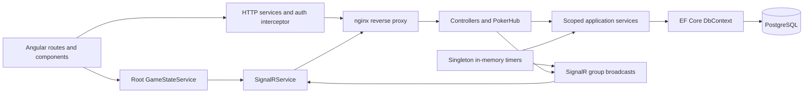

**Estimagator architectural and performance review — September 18, 2026**

Reviewed commit: `e53ad46bb0b6114792d0e2f9835c402c3c30935f`. The working tree was clean before this review. Application source and configuration are unchanged; the additions are this review, the remediation plan, and supporting evidence.

**Assessment**

The existing .NET/Angular/PostgreSQL architecture is appropriate for a planning-poker application. Keep it as a modular monolith. The immediate work is to secure participant identity, make session transitions authoritative and atomic, remove historical data from live operations, and establish reliable release tests. A framework rewrite, microservices, or a general-purpose cache would add risk before resolving these problems.

There are confirmed authorization and vote-confidentiality defects, reproducible client/server state divergence, and a measured database cost that grows sharply with history. Existing passing tests do not establish that these paths work. “Preserve functionality” should mean preserving supported user workflows, UI behavior, and data; it cannot mean retaining unauthorized access or contradictory state.

**Scope, evidence, and limits**

Inspected backend controllers, hub methods, services, authentication, DTOs, entities, migrations, frontend routing/state/authentication/game/admin flows, Docker/nginx configuration, CI workflows, and all existing test suites. Ran existing tests/builds, targeted temporary frontend reproductions, real PostgreSQL service reproductions, a small live-state benchmark, and dependency audits. Used official framework documentation to verify query, proxy, scale-out, and runtime-compatibility recommendations.

| Check | Result |
|---|---|
| Backend tests, .NET SDK 10.0.401 | 65 API tests passed; data and integration projects each passed one placeholder test |
| Frontend `npm test -- --run` | 25 tests passed across 7 files |
| Frontend production build | Passed; initial bundle 335.15 kB raw / 81.62 kB estimated transfer |
| Game-room lazy chunk | 101.11 kB raw / 21.97 kB estimated transfer; shared lazy dependencies are additional |
| Component CSS budget | Warning: 4.68 kB against 4 kB warning budget |
| `npm run test:coverage -- --run` | Failed: missing `@vitest/coverage-v8` |
| Temporary frontend reproductions | 3 additional defect checks passed, alongside 4 reused baseline checks |
| PostgreSQL 16 isolated database | All repository migrations applied; 4 service-level findings reproduced |
| Local live-state benchmark | See measurements below; no production traffic or data used |
| npm audit, all dependencies | 45 flagged package entries: 3 critical, 26 high, 13 moderate, 3 low |
| npm audit, production dependencies | 7 high-severity flagged package entries |
| NuGet restore | 2 high-severity advisory warnings for transitive SSH.NET 2024.1.0 in the integration-test project |

The shell initially selected .NET 8 and failed with NETSDK1045. The already-installed `/usr/local/share/dotnet/dotnet` supplied .NET 10 and ran the tests successfully. Node was 24.18.0. No application dependencies were upgraded.

The local benchmark is a service-call measurement on ARM64 macOS with Docker PostgreSQL, not an HTTP/SignalR load test or production capacity estimate. Browser frame rates, production resource limits, actual proxy topology, backup recoverability, concurrent race outcomes, and account-level GitHub protections were not measured. The existing Playwright suite was inspected but not run end to end; its configuration and assertions need repair. Security findings below distinguish direct reproduction from code-path analysis. Audit severity does not by itself establish exploitability in this application's usage.

**Current architecture**

Useful foundations to retain: lazy-loaded routes, Angular signals and computed values, tracked template lists, scoped DbContexts, async database I/O, separate DTOs, a unique vote-per-story/participant constraint, guest-host tokens stored as hashes, paginated admin lists, bounded visible emoji arrays, reduced-motion handling for emoji effects, gzip, and hashed production JS/CSS.

The main architectural weakness is that the hub orchestrates multi-step domain transitions while the service layer exposes unrestricted entity mutations. HTTP, hub, and timer paths implement overlapping behavior differently. The browser reconstructs a second state machine from unversioned events, while the database lacks a durable pointer to the currently displayed round. These boundaries cause both correctness defects and unnecessary full-state reads.

**Priority and confidence**

P0 means immediate containment; P1 means fix before relying on the affected workflow or scaling traffic; P2 means planned hardening/optimization; P3 means measured cleanup. “Reproduced” means executed against local code, not against production. “Confirmed by inspection” means the call path directly establishes the defect. “Risk” means the implementation permits a problematic interleaving or workload, but that outcome was not load-tested.

**F01 — P0: public participant IDs function as reconnect credentials. Reproduced.**

[ReconnectAsync](/Users/ras/Projects/estimigator/src/backend/PokerPoints/PokerPoints.Api/Services/ParticipantService.cs:71) matches only session and participant IDs, then replaces `ConnectionId`. [JoinSession](/Users/ras/Projects/estimigator/src/backend/PokerPoints/PokerPoints.Api/Hubs/PokerHub.cs:126) accepts that result without checking ownership. Participant IDs and organizer flags are exposed by the anonymous session endpoints. Knowing a room code therefore lets a caller obtain the host ID and reconnect as that host; GUID unpredictability offers no protection once IDs are public. The PostgreSQL harness reconnected an authenticated host with no user identity and retained `IsOrganizer=true`. `UserId ??= userId` can also associate an unowned guest identity with an unrelated authenticated user.

Fix: authenticate registered-user reconnects against their owner; issue a separate high-entropy, hashed guest reconnect credential, scoped to participant and session. Never treat the displayed ID as a secret. Keep the one-time guest-host reservation separate from recurring reconnect credentials. Invalidate or explicitly replace the old connection. Test anonymous takeover, wrong-account takeover, host transfer, valid guest refresh, and old-socket commands. Legacy guest migration cannot securely infer ownership from an ID alone; see the rollout plan.

**F02 — P1: story commands authorize a host but not the target story's session. Confirmed by inspection.**

[UpdateStoryDetails](/Users/ras/Projects/estimigator/src/backend/PokerPoints/PokerPoints.Api/Hubs/PokerHub.cs:555), `DeleteStory`, `StartStory`, and `RestartStory` check the caller's organizer flag, then pass an arbitrary story ID to methods that look up solely by ID. A host in room A who knows a story ID from room B can edit/delete/activate/reset B's story. Start/restart can also complete A's current story before validating B's target. Events are sent to A, further desynchronizing both rooms.

Fix: require `sessionId` and actor context on every story command; query by both IDs and check active-session state inside the transaction before any mutation. Add negative tests using two separate rooms and verify no rows, timers, or events change on rejection.

**F03 — P1: history reveals hidden active votes. Reproduced.**

[GetSessionHistoryAsync](/Users/ras/Projects/estimigator/src/backend/PokerPoints/PokerPoints.Api/Services/SessionService.cs:355) authorizes a registered participant or organizer, then returns every story's vote values regardless of status or session activity. The endpoint is callable during voting. The harness returned card value `5` for an `active` story before reveal.

Fix: enforce one disclosure policy shared by snapshots and history. Preserve room/history metadata, but expose other participants' values only after the relevant round is revealed. If restoring one's own vote, return it only to that participant. Admin access should be explicitly documented as a separate privilege. Test both HTTP and hub representations before and after reveal.

**F04 — P1: revealed rounds cannot be reconstructed, and reset-after-reveal fails. Reproduced/confirmed.**

[GetGameStateAsync](/Users/ras/Projects/estimigator/src/backend/PokerPoints/PokerPoints.Api/Services/SessionService.cs:138) chooses only an `active` story, then checks whether that same story is `completed` at line 164; that branch is unreachable. Reveal sets the story to completed. Subsequent snapshots have neither current story nor revealed votes, which the harness reproduced. Reconnecting, switching roles, or transferring host then replaces a valid results screen with an empty snapshot. [ResetVotes](/Users/ras/Projects/estimigator/src/backend/PokerPoints/PokerPoints.Api/Hubs/PokerHub.cs:400) also requires a current story from this snapshot, so the reset command rejects after reveal.

Fix: represent the displayed round separately from its voting/revealed/completed state, preferably with a durable current-story reference plus round version. Snapshot the same state that event-driven clients display. Preserve averages, consensus, selected card, and timer state. Test reveal → refresh, reveal → role switch, reveal → host transfer, and reveal → vote again.

**F05 — P1: round, host, and vote transitions are not atomic across callers. Risk; missing database invariant reproduced.**

[NextStory](/Users/ras/Projects/estimigator/src/backend/PokerPoints/PokerPoints.Api/Hubs/PokerHub.cs:466) and start/restart execute independent reads/writes; [GetOrCreateActiveStoryAsync](/Users/ras/Projects/estimigator/src/backend/PokerPoints/PokerPoints.Api/Services/SessionService.cs:186) does check-then-insert. Guest-host claim uses a transaction, but its check and claim have no lock or concurrency token. Host-transfer checks occur before its transaction. Concurrent sockets/timers can act on stale state. The schema permits two active stories; the harness demonstrated that with sequential service calls. Registered owners can also join twice without a reconnect ID and receive two organizer participants. Vote insertion is check-then-insert against a unique constraint, so concurrent first votes can fail instead of behaving as an update.

Fix: serialize each session's mutations with a database row lock or optimistic session version and bounded retries; enforce one active round and one live host with suitable schema constraints after cleaning existing conflicts. Use atomic vote upsert/conditional writes. Couple vote acceptance and reveal to the same round version so a late vote cannot change a revealed result. Test simultaneous guest claims, joins, transfers, next/restart, vote/reveal, and reset/vote with independent DbContexts against PostgreSQL.

**F06 — P1: timers can expire the wrong round and cannot survive restart. Confirmed design limit; races are risks.**

[TimerService](/Users/ras/Projects/estimigator/src/backend/PokerPoints/PokerPoints.Api/Services/TimerService.cs:33) keys timers only by access code. Start, extend, stop, and expiry are multi-step operations around a concurrent dictionary, so the dictionary alone does not make them atomic. An old callback removes by key without verifying entry identity; `GetTimerState` does likewise. Expiry then queries whichever story is currently active rather than the story/version it originally timed. Cancellation after the callback's initial check does not prevent the database reveal. Starting a new round stops the server timer but does not consistently broadcast `TimerStopped`; vote-reset handlers do not clear the client timer.

Fix: bind each timer to session ID, story ID, round version, and a unique timer generation. Atomically claim expiry; verify that generation and round in the same command that reveals votes. Emit consistent stop/expire transitions. Dispose timer resources on every completion path. Persist the deadline and recover pending timers if sessions must survive deployments. Test stop/extend exactly at expiry, new-round races, duplicate expiry, server restart, and disconnected clients.

**F07 — P1: live-state reads load and multiply all session history. Measured.**

[GetGameStateAsync](/Users/ras/Projects/estimigator/src/backend/PokerPoints/PokerPoints.Api/Services/SessionService.cs:128) includes sibling participants and stories plus all votes, with tracking and default single-query behavior. [CastVote](/Users/ras/Projects/estimigator/src/backend/PokerPoints/PokerPoints.Api/Hubs/PokerHub.cs:228) loads this entire graph just to locate a current story; role changes load it twice. Cost grows with participant count times historical vote count. This is a query-shape issue, not just a missing index. [EF Core documents the sibling-collection multiplication and split-query tradeoffs](https://learn.microsoft.com/en-us/ef/core/querying/single-split-queries).

Measurements used 20 participants, 20 votes per story, one active story, a fresh DbContext per invocation, two warmups, and five measured service calls in Release mode:

| Total stories | Stored votes | Joined rows | Tracked entities | Median live-state call |
|---:|---:|---:|---:|---:|
| 10 | 200 | 4,000 | 231 | 19.7 ms |
| 100 | 2,000 | 40,000 | 2,121 | 137.1 ms |
| 500 | 10,000 | 200,000 | 10,521 | 595.9 ms |

The 500-story SQL plan confirmed 200,000 output rows and an external merge sort using 51,824 kB of temporary disk. This is approximately 30× the median service time from the 10-story case, without additional concurrent users. Database buffers, JIT, Docker overhead, and host conditions affect absolute times; these are not production percentiles.

Fix: command paths should fetch only actor/session/current-round metadata; snapshots should project participants, the displayed story, and only that round's votes. Keep history behind separate queries. Use no-tracking DTO reads. Split queries can reduce multiplication during an intermediate change, but loading all history remains wasteful and multi-query consistency needs attention. Add a regression gate that live-state SQL does not fetch completed historical votes, then rerun this benchmark.

**F08 — P1: frontend events and snapshots disagree about current state. Reproduced.**

[StoryUpdated handler](/Users/ras/Projects/estimigator/src/frontend/poker-points-app/src/app/core/services/game-state.service.ts:179) assigns every updated story to `_currentStory`, including a pending/history story. A direct hub details update can replace the displayed round without changing the server's active round; pending queue metadata is not updated by that handler. The temporary test reproduced this event behavior. [applyGameState](/Users/ras/Projects/estimigator/src/frontend/poker-points-app/src/app/core/services/game-state.service.ts:249) also leaves `_votingResults` and some `_myVote` state from an earlier round; a fresh unrevealed snapshot retained average `8` in a second reproduction. `VoteCast`/`VotesRevealed` lack round identity; `VotesReset.storyId` is ignored. Concurrent server actions can therefore apply events to the wrong round.

Fix: one tested reducer for snapshots and events, with session/round identity and monotonic version. Update queue items by ID without changing the displayed story unless explicitly transitioning rounds. Reset all round-scoped fields together; reject stale snapshots/events and resync on gaps. Add fields compatibly before enforcing new protocol behavior.

**F09 — P1: login restoration and connection refresh are unreliable. Reproduced/confirmed.**

[loadFromStorage](/Users/ras/Projects/estimigator/src/frontend/poker-points-app/src/app/core/services/auth.service.ts:215) reads a saved refresh token but does not assign it before calling `refreshToken()` for an expired access token. The call returns immediately with no request; a temporary test reproduced this. The HTTP interceptor starts independent refreshes for concurrent 401s, while the server stores only one rotating refresh token per user. [SignalR connect](/Users/ras/Projects/estimigator/src/frontend/poker-points-app/src/app/core/services/signalr.service.ts:65) captures a token once, so reconnects keep supplying the original token even after HTTP refresh. Initial connection failures do not use the automatic reconnect path, and concurrent `connect()` calls can replace an in-progress connection.

Fix: initialize saved refresh state before authentication bootstrap, await readiness in guards, and deduplicate refresh requests. Use a token factory that obtains the current valid token. Serialize connect/disconnect/rejoin, retry initial transient failures with bounded backoff, and show restoration failure. Add expiry, simultaneous 401, network recovery, logout, and multi-tab tests. Keep guest joining available.

**F10 — P1: CI does not reliably gate the image actually deployed. Confirmed by inspection.**

[Deployment](/Users/ras/Projects/estimigator/.github/workflows/deploy.yml:3) starts on main/develop pushes and depends only on environment selection. [A separate publisher](/Users/ras/Projects/estimigator/.github/workflows/docker-build-push.yml:3) builds main images without depending on tests; [the main pipeline](/Users/ras/Projects/estimigator/.github/workflows/pipeline.yml:239) also publishes images. Mutable latest/date tags and independent runs allow deployment before the matching build or after a failed validation. Staging references `:develop`, but neither shown publisher builds develop images.

Fix: one build/test/publish/deploy chain with immutable commit/digest identity, environment concurrency, and a verified deployed build ID. Include develop's artifact path. Preserve Portainer deployment but make its chosen image explicit. Do not assume repository branch protections fix cross-workflow ordering; those settings were not inspected.

**F11 — P1: regression infrastructure has concrete gaps and broken commands. Confirmed; coverage failure reproduced.**

Both data/integration test projects contain only `Assert.True(true)`. Real auth, voting, timer expiry, EF constraints, and transport sequencing lack dedicated coverage. Coverage configuration references an uninstalled provider. [E2E CI](/Users/ras/Projects/estimigator/.github/workflows/e2e-tests.yml:40) specifies .NET 8 for net10 projects; uses `npm ci` in an E2E directory with no committed lockfile; serves a production build with relative `/api` and `/hubs` URLs from `http-server` without a backend proxy; uses a JWT variable name not bound by `Program.cs`; and has inconsistent port assumptions. Its explicit `dotnet ef` step also needs a provisioned tool. These are independent failures, even if a runner happens to include a newer SDK.

[The multiplayer test](/Users/ras/Projects/estimigator/tests/e2e/specs/voting-flow.spec.ts:37) opens a page in the same browser context, sharing localStorage identity with the host instead of creating an independent player. The observer assertion catches and suppresses its own failure. Broad text selectors and loose result assertions further weaken it.

Fix: PostgreSQL integration tests, a functioning isolated E2E stack, separate contexts per participant, stable selectors, exact outcomes, and required failure propagation. Cover negative authorization and reconnection before restructuring services.

**F12 — P1: stale dependencies include runtime and build/test advisories. Audit confirmed; exploitability not assessed.**

The retained [audit summary](/Users/ras/Projects/estimigator/docs/reviews/2026-09-18/evidence/dependency-audit-summary.json) separates all-dependency and production-only results. The 7 production entries are Angular packages; counts represent affected package entries, not distinct exploits. Critical all-dependency entries include Vitest/UI and transitive tar. SSH.NET warnings originate in the integration-test dependency chain, not a demonstrated production SSH feature. See [SSH.NET SCP path handling](https://github.com/sshnet/SSH.NET/security/advisories/GHSA-mggc-4xg6-vcxf) and [recursive-download advisory](https://github.com/sshnet/SSH.NET/security/advisories/GHSA-q939-rpr3-3284).

Fix: update compatible Angular packages as one aligned set; update Vitest and its coverage provider together; update the test-container dependency chain; regenerate locks and rerun behavior/build/security gates. Avoid a blanket forced major-version upgrade. The frontend Docker build uses Node 25, outside [Angular 21's documented supported Node ranges](https://angular.dev/reference/versions); align local, CI, and Docker on a supported pinned version.

**F13 — P2: connection identity and presence have no complete lifecycle. Confirmed design gaps.**

A participant has one `ConnectionId`. Reconnecting in a second tab overwrites the first, while both may remain in SignalR groups. Repeated `JoinSession` calls can create multiple participants sharing one connection or add that connection to multiple groups; lookup/disconnect uses `FirstOrDefault`. Server termination can leave persisted connections marked live because presence is inferred from non-null strings. Root frontend services retain the connection when route destruction alone occurs.

Fix: define one-participant/multiple-connections semantics or explicit takeover, enforce one room per connection unless intentionally supported, make joins idempotent, and use expiring presence/connection generations. Do not delete historical participants merely to clean presence. Test duplicate join, second tab, switching rooms, browser crash, API restart, and late disconnect from a replaced connection.

**F14 — P2: input validation and command acknowledgements are inconsistent. Confirmed.**

Session/story DTOs lack domain validation. Hub inputs are not protected by MVC validation. Unknown deck types, arbitrary card values, overlong names/titles, and invalid timer durations reach services; extension only imposes an upper bound, permitting negatives. Invalid numeric votes can exceed `FinalScore` precision at reveal. Many rejected hub methods send an `Error` event and return successfully; [castVote](/Users/ras/Projects/estimigator/src/frontend/poker-points-app/src/app/core/services/game-state.service.ts:349) then records a local vote anyway. Errors are primarily console-logged.

Fix: central validators for allowed decks/cards, schema-aligned lengths, safe URLs, timer ranges, and bounded import batches; use structured command results or consistent `HubException` behavior. Update local state only after acceptance. Preserve all currently offered cards and timer choices. Characterize special-card scoring first: `½` is offered but current decimal parsing does not count it numerically; changing scoring requires an explicit product decision, not a silent optimization.

**F15 — P2: ended/deleted sessions can retain live controls and stale clients. Confirmed.**

HTTP deactivation calls only [DeactivateSessionAsync](/Users/ras/Projects/estimigator/src/backend/PokerPoints/PokerPoints.Api/Services/SessionService.cs:329); unlike hub end-session, it neither stops the timer nor broadcasts `SessionEnded`. Admin deletion also bypasses timer/group cleanup. Some hub commands check only organizer status, so connected hosts can add/start/restart stories or start timers after HTTP deactivation.

Fix: route HTTP, hub, and admin transitions through shared lifecycle commands, with deliberate delete-vs-end semantics. Check `IsActive` inside every mutation. Publish terminal state, stop timers, and detach or restrict connections. Test all three entry paths with multiple connected clients and a running timer.

**F16 — P2: throttling is narrow, and proxy identity is not applied. Confirmed configuration gap.**

[The limiter](/Users/ras/Projects/estimigator/src/backend/PokerPoints/PokerPoints.Api/Program.cs:70) covers only session creation. Auth/registration/password-email operations, joining, and most costly hub operations have no equivalent controls. BCrypt and synchronous request-path email delivery amplify request cost. nginx forwards client IP headers, but the application does not configure forwarded-header processing; in the supplied proxy deployment, anonymous creation quotas can be shared by everyone behind nginx instead of keyed by original client IP. [Trusted proxy configuration is required](https://learn.microsoft.com/en-us/aspnet/core/host-and-deploy/proxy-load-balancer?view=aspnetcore-10.0).

Fix: configure the actual trusted proxy chain before partitioning limits; never trust arbitrary forwarded headers. Add separate IP/account/session/concurrency policies, bounded import sizes, and useful 429 responses. Keep normal group joins and simultaneous votes comfortably within limits. Document fleet-wide limits before adding replicas.

**F17 — P2: authentication storage and configuration need hardening. Confirmed design issues.**

Refresh/reset/verification tokens are stored in plaintext columns. Refresh/reset consumption lacks an atomic concurrency condition. JWT role claims can remain valid after role changes, account deletion, or password reset until expiration; open hub connections retain established identity. The fallback signing secret is a public development value, with no production startup validation. nginx logs `$request`, including SignalR `access_token` query strings; development email debug logs can contain action links.

Fix: hash opaque tokens, index hashes, atomically consume/rotate them, and define session revocation/security-version checks for sensitive operations. Fail startup for missing/development signing keys outside development. Redact query credentials from logs; restrict debug email contents to explicit local tooling. LocalStorage token exposure to XSS is a design risk, not evidence of an existing exploit; evaluate a secure-cookie refresh design separately with CSRF and deployment tests rather than changing it incidentally.

**F18 — P2: hot lookup indexes and bounded read models are missing. Confirmed shapes; workload impact unmeasured outside F07.**

[Participant configuration](/Users/ras/Projects/estimigator/src/backend/PokerPoints/PokerPoints.Data/PokerPointsDbContext.cs:79) has no `ConnectionId` index despite per-command equality lookups. Token columns are also searched without indexes. Story selection filters session/status and orders by sort order. User sessions load all stories/participants for 20 rooms; history and admin detail materialize full graphs. Admin detail needs vote counts but loads votes. Existing FK indexes and the unique story/participant vote index should be retained; the database is not globally unindexed.

Fix: add a partial connection index after deciding multiplicity, appropriate story-selection indexes/constraints, and unique token-hash indexes as needed. Use DTO projections and server-side aggregates for lists/details, deduplicate participated sessions, and paginate or incrementally load history while preserving access to every item. Search uses substring matching and offset pagination; consider trigram/keyset alternatives only after EXPLAIN and realistic scale justify them. Do not change substring search semantics merely to use a B-tree.

**F19 — P2: resource use grows with connection churn and retained history. Confirmed.**

[EmojiThrowRateLimiter](/Users/ras/Projects/estimigator/src/backend/PokerPoints/PokerPoints.Api/Services/EmojiThrowRateLimiter.cs:12) retains every connection ID indefinitely, with no expiry or disconnect cleanup. Participants/stories/votes are retained unless explicitly deleted, and queue fetch/broadcast includes all pending and completed stories. Presence-heavy snapshots repeat participants inside and outside the session DTO.

Fix: expire limiter entries and remove disconnected keys safely. Bound queue/page payloads without losing history, instrument table/payload growth, and define retention/export policy before any deletion job. Reduce redundant snapshot fields only through a compatible contract transition. Measure fan-out for 5 allowed emoji events/second/connection; visible animation caps do not cap incoming work.

**F20 — P2: single-instance assumptions prevent safe horizontal scaling. Confirmed design limit.**

SignalR groups, timers, and emoji limits are process-local; no backplane/shared timer ownership is configured. A second API instance can split rooms and deadlines. Shared PostgreSQL alone does not solve this. Current Docker stacks deploy a single API, so this is a capacity/deployment constraint, not proof the present stack is already split.

Fix: document/enforce one API instance until scale is required. First remove query waste and add durable round/timer state. For multiple instances, add supported SignalR scale-out, correct affinity for chosen transports, distributed timer ownership and relevant rate limits, then test cross-node reconnect and failure. [Microsoft's scaling guidance](https://learn.microsoft.com/en-us/aspnet/core/signalr/scale?view=aspnetcore-10.0) describes the transport/backplane requirements. A backplane alone does not make domain transitions atomic.

**F21 — P2: operational checks do not establish readiness or recoverability. Confirmed configuration limits.**

[Health](/Users/ras/Projects/estimigator/src/backend/PokerPoints/PokerPoints.Api/Program.cs:161) always reports healthy without querying the database. Startup performs migrations using the serving application's credentials before listening. Repository configuration contains no demonstrated backup/restore validation, telemetry for command latency/database amplification, or durable event publication. Request cancellation is generally not propagated to data operations. Database commits followed by failed broadcasts leave clients stale until a later resync.

Fix: separate liveness/readiness, add bounded database checks and deployed-version reporting, use a controlled migration step, instrument query/command latency and event failures, and propagate cancellation where safe. Add version-based resync first; use a transactional outbox if durable notification delivery is required. Verify backups externally rather than assuming their absence from the repository means none exist. Test upgrade and rollback with an active room.

**F22 — P2: deployment variants and static cache policy drift. Confirmed.**

`docker-compose.prod.yml` omits SMTP/admin settings supplied by stack files and hardcodes `Database=pokerpoints` while its PostgreSQL service accepts `POSTGRES_DB`. nginx caches all matching static extensions for a year as immutable, including unhashed public assets that can change. Index/SPA fallback lacks an explicit revalidation policy. Deployment to a single API/nginx pair interrupts active connections and does not preserve timers.

Fix: validate equivalent environment schemas across production/staging/compose, parameterize the database consistently, restrict immutable caching to versioned assets, and explicitly revalidate the application shell. Test a client left open across deployment, deep links, new lazy chunks, changed brand assets, WebSocket proxying, and fallback transports. Resource limits and connection capacity should follow measured targets; nginx's configured 1,024 worker connections are finite and proxy sockets also consume capacity.

**F23 — P3: frontend structure and animation work need targeted profiling. Confirmed maintenance issues; runtime impact not quantified.**

The game component has 1,121 TS lines and a 1,036-line template, combining domain interactions, layout, modals, geometry, and effects. Template helpers repeatedly calculate positions and look up votes; results lookup is linear per participant. Emoji processing reads layout on every event, while numerous timeouts and the confetti RAF loop are not canceled by [ngOnDestroy](/Users/ras/Projects/estimigator/src/frontend/poker-points-app/src/app/features/game/game-room.component.ts:906). Effects are finite, so this is not evidence of an unlimited browser leak. Existing emoji arrays are capped and subscriptions use lifecycle cleanup.

Fix: separate table/results/timer/actions/effects behind existing state interfaces; precompute participant view models; batch layout reads; track/cancel scheduled work. Preserve visuals and reduced-motion behavior. Profile at 5/20/50 participants before adding virtualization or blanket change-detection changes. Initial bundle size is within its budget, so bundle reduction ranks below server query work.

**F24 — P2: asynchronous UI commands have avoidable stale-result behavior. Confirmed.**

Admin list searches debounce starts but do not cancel or version in-flight requests, so a slower older search can overwrite a newer result. Game story creation followed by URL update waits an arbitrary 100 ms for an event. Joining obtains state through both reconnect push and explicit fetch, followed by a separate queue fetch, without a version protecting against intervening events. Some handlers are missing consistent visible failure/pending state.

Fix: use cancellation or request generation for searches, return accepted story/state from commands, remove time-based sequencing, and apply snapshots/events by version. Test delayed/out-of-order responses, rapid clicks, join failures, and room navigation while a restore is pending.

**Architecture direction and order of work**

Keep transport adapters thin: controllers, PokerHub, and the timer worker should call the same session command layer. That layer owns identity checks, target scope, invariants, transactions, and version increments. Separate projected query services for live snapshots, queue/history, and administration. Keep EF Core directly where it is useful; a generic repository abstraction is not necessary. Share vote-result/disclosure rules rather than recalculating them in several paths. Use typed domain states internally while retaining compatible serialized values.

On the frontend, retain Angular signals and lazy routes. Make connection management responsible for authentication, reconnect, and room membership; make one reducer responsible for session state; make components primarily responsible for presentation and user intent. Expand event payloads with round/version information before removing legacy fields.

The accompanying [remediation plan](/Users/ras/Projects/estimigator/docs/reviews/2026-09-18/REMEDIATION-PLAN.md) sequences these changes into reviewable work, gives acceptance criteria, and identifies the few product decisions needed to avoid accidental behavior changes.
